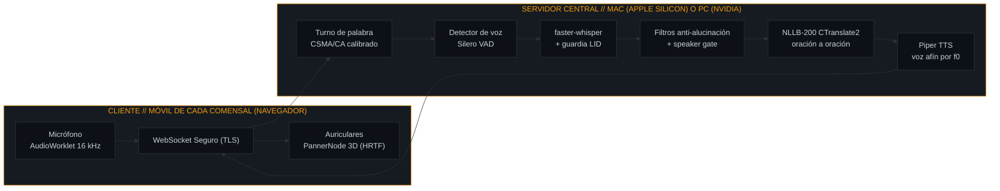

<div align="center">

  <!-- CABECERA DINÁMICA CON SERVIDOR ALTERNATIVO -->
  <a href="https://git.io/typing-svg">
    
  </a>

  <p>
    <strong>Sistema de traducción de voz en tiempo real en red local con posicionamiento acústico 3D y arbitraje automático de micrófonos</strong>
  </p>

  <!-- BADGES ROBUSTOS CON URLS CODIFICADAS SIN CARACTERES PROBLEMÁTICOS -->
  
  
  
  
  

</div>

<br>

---

### `// 01. DESCRIPCIÓN GENERAL DEL SISTEMA`

**TradIon** convierte una mesa física en una mesa multilingüe: cada persona habla en su idioma a su propio móvil y escucha a los demás **traducidos, con una voz afín a la de cada hablante y sonando desde el sitio real donde está sentado** (audio 3D). Todo el procesamiento —reconocimiento, traducción y síntesis de voz— ocurre en **un único ordenador de la casa**: sin nubes, sin cuotas, sin instalar aplicaciones (los móviles entran directamente por el navegador).

* **Idiomas soportados:** **Español · 한국어 · English** (matriz completa bidireccional en cualquier dirección).

<br>

### `// 02. ESPECIFICACIONES Y FUNCIONALIDADES CLAVE`

| Funcionalidad | Especificación técnica y comportamiento operativo |
| :--- | :--- |
| **Traducción de voz en tiempo real** | Frase cerrada → traducida y hablada en **~0,5–1,5 s** (NVIDIA RTX 3070) o **~1,5–4,0 s** (MacBook M3), medidos en sesiones reales. |
| **Subtítulos en vivo** | Ves la transcripción crecer *mientras* la persona habla mediante un modelo dedicado que jamás compite con la cola de traducciones. |
| **Turno de palabra automático** | Un árbitro tipo walkie-talkie (`CSMA/CA`) decide qué micrófono emite, **calibrado por dispositivo**: cada micro compite relativo a su propio nivel de voz, evitando que un móvil con micrófono más sensible robe el canal. Incluye histéresis, anti-acaparamiento y autocorrección de robos. |
| **Anti cross-captura** | Si tu micro capta la voz del vecino, una guardia de idioma (`LID` con salvaguardas) la descarta y devuelve el canal; un verificador de locutor (huella del *enroll*) registra telemetría por segmento. |
| **Voz afín por idioma** | En la calibración se mide tu frecuencia fundamental ($f_0$) y se te asigna la voz del catálogo más parecida **para cada idioma destino** —puedes escucharla y cambiarla antes de entrar—. Clonación *Zero-Shot* real (`F5-TTS`) disponible como modo de calidad opcional. |
| **Audio 3D colaborativo** | Plano de la mesa arrastrable y **compartido**: cualquiera recoloca a cualquiera y la voz de cada persona suena desde su asiento real mediante funciones de transferencia relativas a la cabeza (`HRTF`). Requiere auriculares (idealmente de cable). |
| **Calibración validada por voz** | El *enroll* te pide leer frases y las valida por reconocimiento (tolerante a acentos); de ahí se extraen tu huella vocal, tu tono ($f_0$) y la ganancia base de tu micrófono. |
| **Reconexiones invisibles** | Un micro-corte de red reconecta en **1–2 s** conservando identidad, voz, asiento y subtítulos sin interrumpir la sesión de la mesa. |
| **Interfaz trilingüe** | Toda la interfaz de usuario en `es` / `ko` / `en`, con telemetría de estado en pantalla: quién tiene el turno, por qué no te oyen o si tienes el micrófono silenciado. |
| **Arranque sin internet** | Tras la primera descarga de modelos, el servidor arranca y funciona **100 % offline**. |
| **Diagnóstico de audio 3D** | Página integrada en `/static/diag.html` para medir en 2 minutos qué capacidades ofrece cada conjunto de móvil + auriculares (estéreo real, firma Bluetooth HFP y prueba binaural). |

<br>

### `// 03. ARQUITECTURA Y FLUJO DE PROCESAMIENTO`



1. **Captura:** Tu móvil re-muestrea el micrófono a $16\text{ kHz}$ y lo envía por WebSocket seguro (`WSS`). Empiezas silenciado por defecto (como en Zoom).
2. **Turno:** El primer micro con voz franca *relativa a su propia calibración* toma el canal; los demás se silencian en el servidor (así tu eco en el móvil de enfrente no genera duplicados). El turno se libera automáticamente a los $600\text{ ms}$ de silencio.
3. **Segmentación:** Un detector neuronal de actividad de voz (`Silero VAD`) corta tus frases con contexto (*pre-roll*) y sin trocear pausas naturales.
4. **Transcripción:** `faster-whisper` opera junto a una **guardia de idioma**: si detecta con confianza alta otro idioma *de la sala* en tu micro, deduce que es la voz del vecino y la descarta (dos detecciones seguidas devuelven además el canal); si duda (por acentos), re-transcribe forzando tu idioma para no perder nunca tu intervención.
5. **Filtros:** Control de confianza, lista negra de alucinaciones, filtro anti-degeneración y un **verificador de locutor** que compara cada segmento con tu huella vocal del *enroll* (en modo telemetría hasta calibrarse con las voces reales de tu mesa).
6. **Traducción:** `NLLB-200` (`int8`) procesando **oración a oración**, con topes anti-alucinación y recorte de diálogos inventados.
7. **Síntesis:** `Piper TTS` genera la voz asignada a tu tono ($f_0$) en $< 150\text{ ms}$ (pre-calentada durante la fase de calibración).
8. **Reproducción 3D:** Cada oyente recibe subtítulo + traducción a su idioma + flujo de audio, que suena desde el asiento real del hablante (en una mesa hexagonal arrastrable y sincronizada para todos los participantes).

> **Privacidad por diseño:** La huella vocal vive únicamente en memoria RAM y en un archivo WAV temporal que se purga al salir y se barre al arrancar; ningún dato abandona tu red local.

<br>

### `// 04. PROTOCOLO DE INSTALACIÓN (PASO A PASO)`

Los móviles acceden directamente por navegador web — **sin instalar ninguna aplicación**.

#### 1. Certificados de red (requisito de los navegadores)
Los navegadores móviles exigen conexión segura (`HTTPS`) para permitir el acceso al micrófono. Instala `mkcert` a nivel de sistema:
* **Mac:** `brew install mkcert`
* **Windows:** `winget install mkcert`

> [!NOTE]
> Tras instalar `mkcert`, cierra la consola actual y abre una nueva para actualizar las variables de entorno.

#### 2. Clonar el repositorio y crear el entorno virtual

```bash
git clone https://github.com/pttb6dhg24-tech/TradIon.git
cd TradIon
python -m venv .venv

# Mac (zsh/bash):
source .venv/bin/activate
# Windows (CMD/PowerShell):
.venv\Scripts\activate

pip install -r requirements.txt
```

#### 3. Generar los certificados locales

> [!IMPORTANT]
> **Incluye la IP local de tu ordenador** en el certificado: sin ella, los móviles verán un candado inválido y no podrán encender el micrófono. Averíguala ejecutando `ipconfig getifaddr en0` (en Mac) o `ipconfig` (en Windows, mirando el campo *Dirección IPv4*).

```bash
mkcert -install
# Sustituye 192.168.1.50 por TU IP local:
mkcert -cert-file config/certs/tradion.pem -key-file config/certs/tradion-key.pem localhost 127.0.0.1 ::1 192.168.1.50
```

Instala además la entidad certificadora raíz (CA) de `mkcert` en cada móvil (el comando `mkcert -CAROOT` te indica la ruta exacta donde se encuentra el archivo `rootCA.pem`).

> [!CAUTION]
> **Los certificados son secretos y NUNCA deben subirse al repositorio** (el archivo `.gitignore` ya bloquea el directorio `config/certs/` entero). Si una clave privada llega a incluirse en un *commit* alguna vez, bórrala **y además regenera los certificados** —eliminar el fichero en un commit posterior no lo borra del historial público de Git—.

#### 4. Elegir la configuración de tu hardware
Copia la plantilla correspondiente a tu arquitectura como configuración activa:
* **Mac (Apple Silicon):** `cp config/settings.mac.yaml config/settings.yaml`
* **Windows (NVIDIA):** `Copy-Item config\settings.windows.yaml config\settings.yaml`

> [!WARNING]
> **Windows (NVIDIA):** Para que CUDA encuentre sus librerías dinámicas en el entorno virtual, ejecuta:
> ```cmd
> pip install nvidia-cublas-cu12 nvidia-cudnn-cu12
> copy .venv\Lib\site-packages\nvidia\cublas\bin\*.dll .venv\Scripts\
> copy .venv\Lib\site-packages\nvidia\cudnn\bin\*.dll .venv\Scripts\
> ```

#### 5. Descargar el catálogo de voces

```bash
# Mac / Linux:
bash scripts/setup_voices.sh

# Windows (mismo resultado, sin requerir bash):
python -m piper.download_voices --data-dir models/piper es_ES-davefx-medium es_ES-carlfm-x_low es_ES-sharvard-medium es_MX-claude-high es_MX-ald-medium en_US-amy-medium en_US-ryan-high en_US-lessac-medium en_GB-alan-medium ko_KR-kss-medium
```

#### 6. (Opcional) Verificador de locutor — Speaker Gate

```bash
pip install sherpa-onnx
python scripts/setup_speaker_gate.py
python scripts/bench_speaker_gate.py
```

Arranca por defecto **en modo sombra** (solo registra telemetría en los logs, jamás descarta intervenciones). Calíbralo primero con dos voces reales de tu mesa (`python scripts/bench_speaker_gate.py voz1.wav voz2.wav`) antes de activar `enforce: true` en `config/settings.yaml`.

#### 7. Arrancar el servidor

```bash
python -m backend.main_server
```

La primera vez descargará los modelos de IA en el directorio `models/` (proceso de varios minutos). A partir de ese momento, **arranca y funciona completamente sin internet**.

<br>

### `// 05. ACTUALIZACIÓN DEL SERVIDOR (WINDOWS / POWERSHELL)`

Tras cada `git pull`, restaura tu configuración activa desde la plantilla para evitar conflictos de *merge*:

```powershell
git pull
Copy-Item config\settings.windows.yaml config\settings.yaml -Force
```

> [!TIP]
> PowerShell 5.1 no acepta el operador `&&` para encadenar comandos: ejecútalos en líneas separadas (o sepáralos con `;`). Tras actualizar, los móviles deben recargar la página una vez (el servidor sirve el frontend con cabeceras `no-cache`, pero la primera recarga tras una versión antigua puede requerir cerrar y reabrir la pestaña del navegador).

<br>

### `// 06. TOPOLOGÍA DE CONECTIVIDAD`

#### A) Modo recomendado: WiFi local (offline absoluto)
Máxima privacidad, mínima latencia y cero cortes. Solo necesitas que los móviles y el servidor compartan la misma red WiFi.

1. **Windows:** Permite el tráfico del puerto en el firewall (una sola vez, ejecutando PowerShell como Administrador y con la red WiFi configurada bajo perfil "Privado"):
   ```powershell
   netsh advfirewall firewall add rule name="TradIon 8443" dir=in action=allow protocol=TCP localport=8443 profile=private remoteip=localsubnet
   ```
2. Arranca el servidor y accede desde el navegador de los móviles a `https://<IP-DE-TU-ORDENADOR>:8443`.

#### B) Túnel de Cloudflare (solo para pruebas puntuales)

```bash
cloudflared tunnel --url https://localhost:8443 --no-tls-verify
```

> [!CAUTION]
> **El enlace del túnel NO es privado y la mesa no tiene autenticación:** cualquiera que conozca la URL puede entrar, escuchar las traducciones y dejar muestra de su voz. Además, el túnel corta las conexiones WebSocket con *timeouts* de $\sim 100\text{ s}$ y añade entre $50\text{ ms}$ y $200\text{ ms}$ de latencia. Úsalo únicamente para pruebas breves con personas de confianza; para uso real, utiliza siempre WiFi local.

<br>

### `// 07. RECOMENDACIONES ACÚSTICAS Y CONFIGURACIÓN`

* **Auriculares de cable** para experimentar el audio 3D completo: el filtrado `HRTF` es binaural y reproducirlo por el altavoz del móvil es físicamente imposible.
* **Bluetooth:** Sirve para *escuchar*, pero **su micrófono integrado no debe usarse** —al activar el micrófono Bluetooth, tanto iOS como Android conmutan automáticamente al perfil de telefonía (`HFP`, audio mono de banda estrecha) y el reconocimiento de voz se degrada gravemente (comprobado en sesiones reales)—. Utiliza siempre el micrófono físico del propio móvil.
* Coloca cada móvil cerca de su dueño; habla con claridad y deja que la frase termine (el turno se libera tras $600\text{ ms}$ de silencio).
* Ante cualquier duda técnica, abre `https://<IP>:8443/static/diag.html` en el móvil: analiza tu ruta de audio en tiempo real y detalla sus capacidades exactas.

#### Parámetros principales en `config/settings.yaml`

Toda la configuración reside en `config/settings.yaml` (sin valores *hardcodeados* en el código). Las claves más relevantes son:

| Clave de configuración | Función y parámetro controlado |
| :--- | :--- |
| `stt.model_size` / `device` | Tamaño del modelo Whisper y motor de ejecución (`CPU` / `CUDA`), pre-afinados en las plantillas de cada hardware. |
| `audio.segment_close_silence_ms` | Duración del silencio que cierra una frase ($600\text{ ms}$: punto de equilibrio entre frases completas y baja latencia). |
| `room.floor.*` | Parámetros del turno de palabra: umbrales relativos, ventana de contienda y límite anti-acaparamiento. |
| `stt.lid_crosstalk_min_prob` | Umbral de confianza mínima para descartar voz ajena por detección de idioma cruzado. |
| `stt.speaker_gate.*` | Configuración del verificador biométrico de locutor (modos `shadow` / `enforce` y umbrales de similitud). |
| `tts.backend` | Motor de síntesis: `piper` (rápido, $< 150\text{ ms}$, activo por defecto) o `f5tts` (clonación vocal real, mayor latencia). |

<br>

### `// 08. ESTRUCTURA DEL REPOSITORIO Y HOJA DE RUTA`

```text
TradIon/
├── backend/    :: Servidor aiohttp, motores (core_engine, translation, tts, speaker_gate)
├── frontend/   :: PWA vanilla: lobby, mesa interactiva, audio-worklet, diagnóstico 3D
├── config/     :: settings.yaml + plantillas por hardware (certs/ NUNCA se versiona)
├── scripts/    :: Descarga de voces, speaker gate, benchmarks, MeCab coreano
├── models/     :: Pesos de los modelos de IA (se descargan localmente; fuera del repo)
└── docs/       :: DOCUMENTO_MAESTRO.md — arquitectura, decisiones y diario de ingeniería
```

#### Hoja de ruta (Roadmap)
* **F12 — "Tela de araña":** Anillos concéntricos de distancia en el plano 3D + filtro acústico de absorción de "aire" según lejanía + modos *Sutil* e *Inmersivo*.
* **Speaker gate en modo `enforce`:** Activación del bloqueo estricto tras la calibración en vivo con las voces reales de cada mesa.
* **Control de acceso mediante PIN:** Autenticación de sala para despliegues expuestos fuera de la red LAN.

<br>

### `// 09. LICENCIA Y RÉGIMEN LEGAL`

**TradIon** es **software libre**, publicado bajo la licencia **[AGPL-3.0-or-later](LICENSE)**.

`Copyright © 2026 24-TECH (pttb6dhg24-tech) — Independent R&D.`

Puedes usarlo, estudiarlo, modificarlo y redistribuirlo, **incluso comercialmente**. La única condición del *copyleft*: si distribuyes el programa —o lo ofreces como servicio a través de una red— debes poner el código fuente correspondiente a disposición de esos usuarios, bajo esta misma licencia. El uso privado y el uso interno dentro de una organización **no generan ninguna obligación**.

#### Licencia comercial (modelo dual)
Si deseas integrar **TradIon** en un producto propietario o tu política corporativa interna no admite la licencia AGPL, existe disponible una **licencia comercial** que exime de las obligaciones del *copyleft*. El autor conserva el 100 % de los derechos patrimoniales sobre el código propio, por lo que puede otorgarla directamente.

* **Licencias comerciales y soporte técnico:** [4-berro.ruedas@icloud.com](mailto:4-berro.ruedas@icloud.com)

> [!CAUTION]
> **La licencia de TradIon no cubre los modelos de terceros que descarga.**
>
> Por defecto se utiliza **NLLB-200** (Meta), publicado bajo licencia **CC-BY-NC-4.0**, la cual **prohíbe el uso comercial** —y dicha cláusula restringe *el uso mismo*, no solo la redistribución, por lo que no basta con que los pesos los descargue el usuario final—. Tres voces del catálogo de Piper (incluida `ko_KR-kss`, la única voz coreana por defecto) tienen asimismo licencias no comerciales.
>
> Antes de realizar cualquier explotación comercial, establece `licensing.commercial_use: true` en `config/settings.yaml`: **TradIon** auditará su propia configuración al arrancar y te indicará exactamente qué componente debes sustituir.
>
> El desglose completo —cada componente, su licencia exacta y su fuente— se encuentra documentado en **[THIRD_PARTY_LICENSES.md](THIRD_PARTY_LICENSES.md)**, junto con los modelos sustitutos de licencia permisiva ya verificados.
